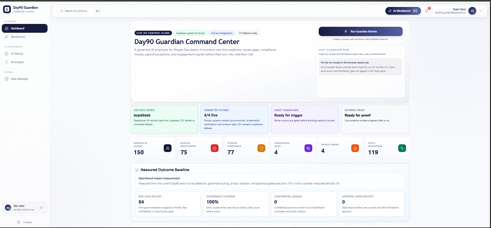
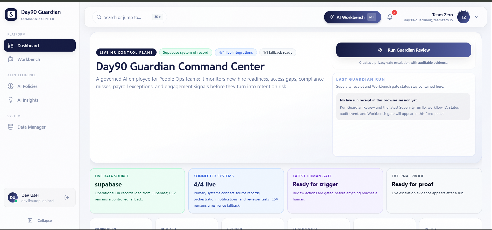
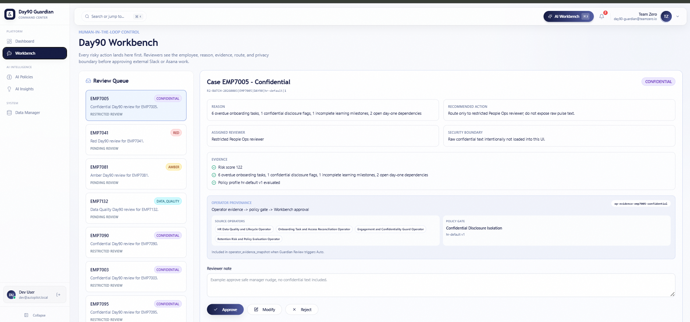
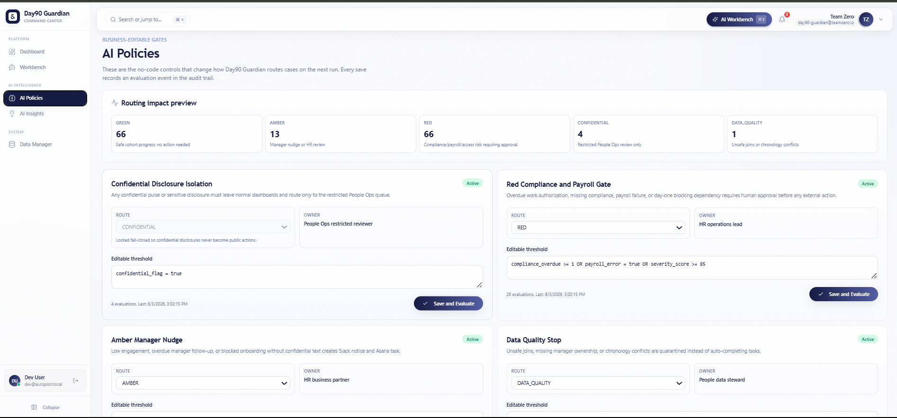
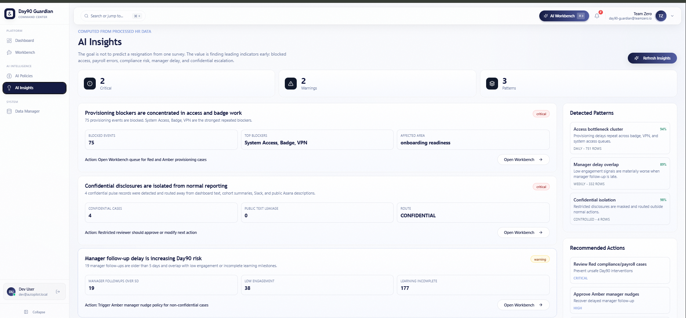
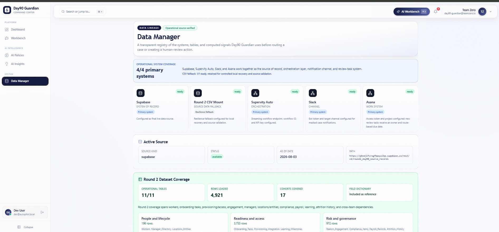
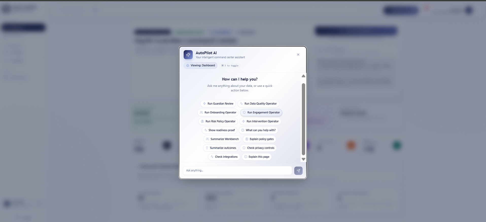
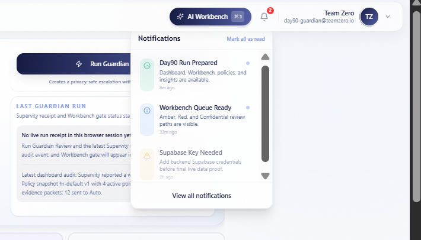
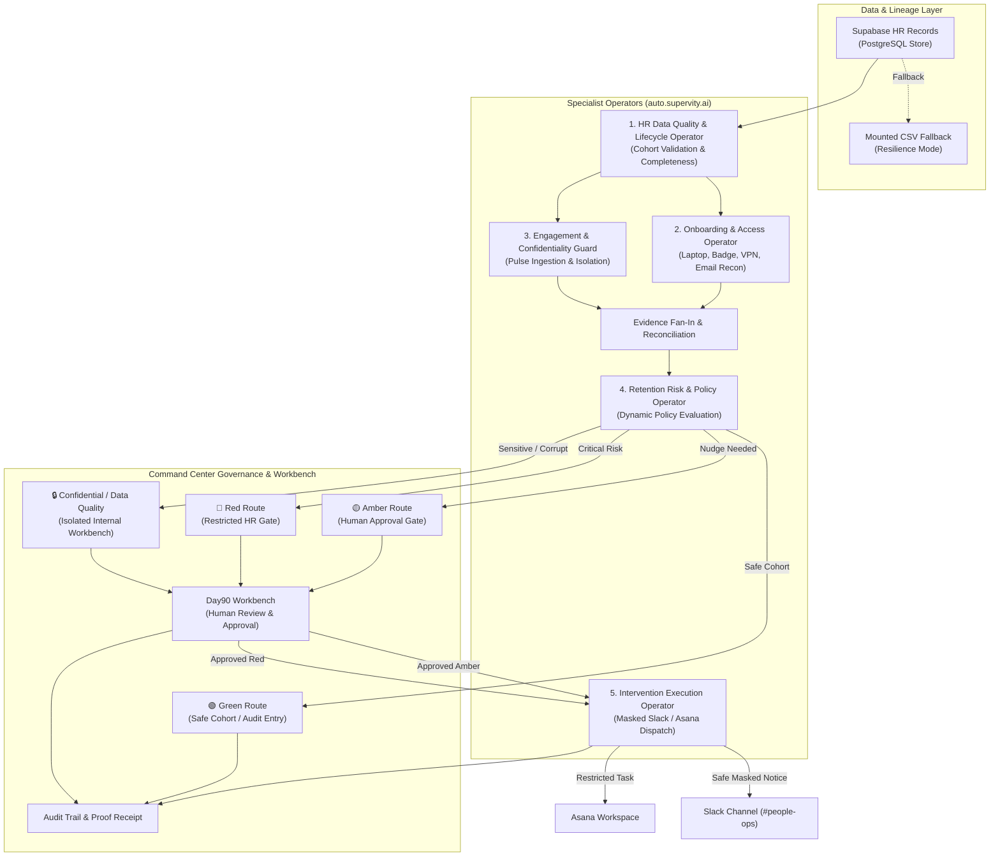

# 🛡️ Day90 Guardian Command Center

<div align="center">

[](https://auto.supervity.ai)
[](https://fastapi.tiangolo.com/)
[](https://nextjs.org/)
[](https://www.typescriptlang.org/)
[](https://tailwindcss.com/)
[](https://supabase.com/)
[](https://www.docker.com/)
[](https://opensource.org/licenses/MIT)

<p align="center">
  <strong>An Autonomous, Governed AI Employee for People Operations & Employee Success</strong>
</p>

<p align="center">
  <em>Catch onboarding friction, access bottlenecks, compliance oversights, payroll discrepancies, and disengagement signals before they escalate into costly retention failures.</em>
</p>

[🌐 Live Hosted UI](https://day90-guardian-command-center-ui.vercel.app/) • [⚡ API Health Check](https://day90-guardian-api-git-main-waseem-mushtaqs-projects.vercel.app/api/health) • [📖 Architecture Guide](docs/command-center-guide.md) • [📋 Acceptance Checklist](docs/round2-acceptance-checklist.md)

</div>

---

## 📌 Executive Summary

The first **90 days** of employment dictate an employee’s long-term retention, productivity, and organizational sentiment. However, People Ops teams operate in a fragmented reality: HR data is splintered across onboarding task portals, IT access provisioning systems, compliance trackers, payroll engines, manager check-in notes, and pulse surveys.

Most traditional dashboards report churn **reactively** — often when an exit interview has already been scheduled.

**Day90 Guardian** transforms People Operations into a proactive, closed-loop operating system:
> **Evidence → Specialist Agent Checks → Business Policy Evaluation → Human Approval Gate → Masked Action Receipt → Cryptographic Audit Trail.**

```
       ┌────────────────────────────────────────────────────────┐
       │              Day90 Guardian AI Employee                │
       │                                                        │
       │  [HR Records] ──► [5 Specialist Operators] ──► [Gates] │
       └───────────────────────────┬────────────────────────────┘
                                   │
              ┌────────────────────┴────────────────────┐
              ▼                                         ▼
   [Route-Safe Automation]                   [Human-in-the-Loop]
   • Masked Slack Nudges                     • Restricted HR Workbench
   • Asana Task Delegation                   • Zero-Leakage Privacy Guard
   • Transparent Audit Proof                 • Business-Editable Rules
```

---

## 🌟 Key Performance & Governance Metrics

| Metric | Measured Baseline | Impact & Significance |
| :--- | :---: | :--- |
| **Governance Coverage** | **100%** | Every consequential or external action is gated behind human verification. |
| **Confidential Leakage** | **0%** | Raw pulse feedback and sensitive disclosures are completely isolated from general channels. |
| **Source Data Lineage** | **11 / 11** | Full operational table coverage ingesting **4,921+** HR records across **17 cohorts**. |
| **Connected Integrations** | **4 / 4** | Live production connections: Supabase, Supervity Auto, Slack Bot, and Asana. |
| **Proactive Risk Discovery** | **75 Blockers** | Instant reconciliation of IT access, badge, and VPN bottlenecks before Day 1. |
| **Idempotent Execution** | **Zero Dupes** | Repeat approvals return cached cryptographic receipts with no duplicated external tasks. |

> *Below: Live cohort health telemetry and measured outcome baselines captured directly from the command center control plane.*



---

## 📸 Product Walkthrough & Command Center Tour

### 1. Command Center Executive Dashboard
> *The real-time operational cockpit for People Ops leadership, monitoring new-hire cohort health, operator flow, integration status, and audit receipts.*



* **Cohort Overview**: Instant snapshot of active cohorts (150+ workers), access gaps, compliance misses, and payroll exceptions.
* **Live System Status**: Monitors primary operational systems (Supabase, Supervity Auto, Slack, Asana) with automated local CSV fallback.
* **Supervity Execution Panel**: Live tracker displaying latest run IDs, workflow status, audit events, and human-gate readiness.

---

### 2. Human-in-the-Loop AI Workbench
> *"A system that gracefully handles what it can't do is more impressive than a system that tries to do everything and fails silently."*



* **Triage Queues**: Dynamically groups cases by severity: `Green`, `Amber`, `Red`, `Confidential`, and `Data Quality`.
* **Zero-Leakage Security Boundary**: Raw pulse text is intentionally stripped from UI elements and integration payloads to preserve psychological safety.
* **Operator Provenance Drawer**: Complete transparency into which operator detected each signal, which policy triggered the route, and recommended next steps (`Approve`, `Modify`, `Reject`).

---

### 3. Business-Editable AI Policies (No-Code Governance)
> *Empower People Ops leaders to fine-tune risk thresholds and escalation triggers without code deployments or developer dependencies.*



* **Routing Impact Preview**: Simulates immediate policy changes on live cohorts (e.g., 66 Green, 13 Amber, 4 Confidential) before committing.
* **Configurable Policy Gates**:
  * 🔒 **Confidential Disclosure Isolation**: Strict isolation routing sensitive disclosures exclusively to restricted People Ops reviewers.
  * 🚨 **Red Compliance & Payroll Gate**: Overdue work auth, missing compliance, or payroll errors halt automated processing and require manual review.
  * ⚠️ **Amber Manager Nudge**: Automated route-safe Slack and Asana nudges when manager check-ins are overdue.
  * 🛑 **Data Quality Quarantine**: Unsafe joins, orphan records, or chronology conflicts are quarantined instead of making erroneous assumptions.

---

### 4. AI Insights & Leading Indicator Analytics
> *Proactive anomaly detection that moves beyond static churn prediction to uncover actionable operational bottlenecks.*



* **Bottleneck Clustering**: Surfaces root causes behind onboarding delays (e.g., 75 provisioning events blocked across System Access, Badge, and VPN).
* **Manager Delay Overlap**: Discovers cross-domain correlations where late manager follow-ups compound low employee engagement.
* **Prioritized Action Plan**: Generates high-impact intervention suggestions with direct links to triage queues.

---

### 5. Data Manager & Source Lineage Registry
> *Complete end-to-end data transparency: audit every system of record, source table, and computed signal driving AI decisions.*



* **Operational Coverage**: Ingests and reconciles 11 core HR data domains: `Workers`, `Onboarding Tasks`, `Provisioning/Access`, `Engagement Records`, `Manager Directory`, `Locations/Entities`, `Compliance Items`, `Payroll Records`, `Learning Milestones`, `Attrition History`, and `Cross-Team Dependencies`.
* **Data Resiliency**: Built-in automated fallback between live Supabase PostgreSQL and mounted production CSV schemas.

---

### 6. AutoPilot AI Conversational Control Layer & Run Notifications
> *An interactive AI Manager embedded directly in the command center for natural-language queries, manual operator dispatch, and policy explanations.*



* **On-Demand Operator Triggers**: Trigger specific specialist operators (`Data Quality`, `Onboarding`, `Engagement`, `Risk Policy`, `Intervention`) directly from the chat interface.
* **Governance Inquiries**: Ask the assistant to explain policy rules, check privacy controls, or summarize current Workbench queues.
* **Real-Time Notification Hub**: Live feed tracking operator readiness, workflow run preparations, and human workbench updates.

<div align="center">
  
</div>

---

## 🤖 Multi-Agent AI Employee Architecture

Day90 Guardian is modeled as a unified **AI Employee** powered by specialized, decoupled **Operator Agents** orchestrated via **[Supervity Auto](https://auto.supervity.ai)**:



### Specialist Operator Directory

| Operator | Supervity Key | Primary Mission | Safety Boundary |
| :--- | :--- | :--- | :--- |
| **HR Data Quality & Lifecycle** | `data_quality` | Validates worker cohorts, lifecycle stages, manager hierarchy, and source completeness. | Fails closed on missing managers or orphan records. |
| **Onboarding & Access Recon** | `onboarding` | Reconciles task completion with actual IT provisioning logs (laptops, badges, VPN). | Prevents premature task closure without hardware confirmation. |
| **Engagement & Confidentiality** | `engagement` | Detects non-response patterns, survey drops, and sensitive emotional disclosures. | **Zero-Leakage**: Strips raw confidential text from external outputs. |
| **Retention Risk & Policy** | `risk_policy` | Evaluates multi-signal risk profiles against active business policies and assigns routing. | Deterministic scoring; records policy version hash in audit. |
| **Intervention & Execution** | `intervention` | Dispatches approved Slack alerts and Asana tasks with masked metadata. | **Idempotent**: Verifies prior execution before firing external APIs. |

---

## 🚦 Governed Routing & Escalation Matrix

To ensure enterprise-grade safety, Day90 Guardian categorizes all employee cases into distinct, policy-governed routes:

```
                  ┌──────────────────────────────────────────────┐
                  │          Computed Risk Evaluation            │
                  └──────────────────────┬───────────────────────┘
                                         │
         ┌───────────────┬───────────────┼───────────────┬───────────────┐
         ▼               ▼               ▼               ▼               ▼
     [ GREEN ]       [ AMBER ]        [ RED ]     [CONFIDENTIAL]  [DATA QUALITY]
      Score < 40      Score 40-74     Score ≥ 75    Sensitive Text  Orphan / Null
         │               │               │               │               │
     Safe Cohort    Manager Nudge   Critical Risk   Isolated Queue   Quarantined
         │               │               │               │               │
     Auto-Log       Human Review    HR-Only Gate    Restricted HR   Data Steward
     Audit Trail     Workbench       Workbench       Workbench       Workbench
         │               │               │               │               │
     No Action     Masked Slack    Private Asana     Zero Public     No Public
      Artifact     & Asana Task     Project Only       Payload        Artifact
```

| Route | Conditions & Triggers | System Behavior | External Visibility |
| :--- | :--- | :--- | :--- |
| 🟢 **Green** | Healthy onboarding, timely manager check-ins, access confirmed. | Logs clean outcome directly to audit trail; no manual action required. | **None** |
| 🟡 **Amber** | Overdue manager 1-on-1 (>5 days), low survey engagement, minor delay. | Places case in Workbench queue. Upon approval, dispatches masked manager nudge. | **Masked Slack Notice + Assigned Asana Task** |
| 🔴 **Red** | Visa/work auth expiration, missed compliance deadline, payroll failure, Day-1 blocker. | Halts automation. Places case in restricted HR queue. | **Private HR Asana Project Only** *(Never public Slack)* |
| 🔒 **Confidential** | Sensitive pulse feedback, personal disclosure, emotional distress flags. | Isolates raw text completely. Strips details before reaching UI or API payloads. | **Strictly Internal to Restricted HR Queue** |
| ⚪ **Data Quality** | Chronology conflicts, missing manager references, corrupted records. | Quarantines case to prevent hallucinated decisions or invalid actions. | **Internal Data Steward Queue Only** |

---

## 🔒 Enterprise Privacy & Security Model

Day90 Guardian adheres to strict enterprise privacy principles:

1. **Synthetic Data & Zero-Leakage Architecture**:
   * Raw confidential pulse feedback is intentionally stripped by the backend before reaching the frontend or external API layers.
   * Reviewers see synthetic risk tokens (e.g., `Risk Score: 122`, `Overdue Tasks: 6`) rather than sensitive verbatim disclosures.
2. **Cryptographic Idempotency**:
   * Every intervention request computes an idempotent hash from the case ID, batch version, and route. Repeated approval clicks return existing execution receipts with zero duplicate messages sent.
3. **Secret-Safe Readiness Endpoints**:
   * Integration diagnostic endpoints (`/api/day90/integrations`) return binary `configured` / `missing` status and never leak token fragments or secret hashes.
4. **Role-Based Access Control**:
   * Demo environments default to gated authentication (`DEMO_AUTH_REQUIRED=true`), separating standard viewers from privileged HR Operations reviewers.

---

## 🛠️ Technology Stack

<div align="center">

| Layer | Technologies |
| :--- | :--- |
| **Frontend Platform** | Next.js 15 (App Router), React 19, TypeScript, Tailwind CSS, Lucide Icons |
| **UI Components** | Radix UI Primitives, NextAuth.js, Custom Data Viz & Metric Drawers |
| **Backend & APIs** | FastAPI, Python 3.11+, Pydantic v2, SQLAlchemy 2.0, Uvicorn, Gunicorn |
| **Agent Orchestration** | [Auto by Supervity](https://auto.supervity.ai), Multi-Agent Workflow Engine |
| **Database & Lineage** | Supabase (PostgreSQL), Alembic Migrations, Mounted CSV Fallback |
| **Enterprise Integrations** | Slack Webhook/Bot API, Asana Task API, Supervity Execution API |
| **DevOps & Verification** | Docker Compose, GitHub Actions CI, Pytest, Windows PowerShell Scripts |

</div>

---

## 🚀 Quick Start Guide

### Prerequisites
* [Docker Desktop](https://www.docker.com/products/docker-desktop/) (recommended for containerized execution)
* [Python 3.11+](https://www.python.org/) & [Node.js 20+](https://nodejs.org/) (for manual local execution)
* [Git](https://git-scm.com/)

---

### Option A: Quick Launch with Docker Compose (Recommended)

1. **Clone the repository:**
   ```bash
   git clone https://github.com/Hasnain006-nain/day90-guardian-command-center.git
   cd day90-guardian-command-center
   ```

2. **Configure environment variables:**
   ```bash
   cp .env.example .env
   ```

3. **Spin up all services:**
   ```bash
   docker compose up --build -d
   ```

4. **Access the application:**
   * 🖥️ **Command Center UI**: [http://localhost:3001](http://localhost:3001)
   * 📚 **Interactive Swagger API Docs**: [http://localhost:8001/api/docs](http://localhost:8001/api/docs)
   * 🩺 **Backend Health Probe**: [http://localhost:8001/api/health](http://localhost:8001/api/health)

---

### Option B: Local Native Development

<details>
<summary><strong>Click to expand manual setup instructions</strong></summary>

#### Backend Setup (FastAPI)
```bash
# Create and activate virtual environment
python -m venv venv
# On Windows:
.\venv\Scripts\activate
# On Linux/macOS:
source venv/bin/activate

# Install dependencies
pip install -r requirements.txt
pip install -r packages/requirements-dev.txt

# Run migrations & seed data
python scripts/reset_db.py
python scripts/seed_db.py

# Launch FastAPI server
uvicorn app.main:app --host 0.0.0.0 --port 8001 --reload
```

#### Frontend Setup (Next.js 15)
```bash
cd frontend

# Install npm packages
npm install

# Launch development server
npm run dev -- -p 3001
```

</details>

---

## 🧪 Testing & Quality Verification

The test suite enforces end-to-end reliability across integration readiness, privacy stripping, route safety, and approval idempotency:

```bash
# Run pytest inside the backend container
docker compose exec backend pytest -q

# Or run the comprehensive Round 2 verification script (PowerShell)
powershell -ExecutionPolicy Bypass -File .\scripts\verify-round2.ps1
```

### Verified Test Categories
* ✅ **Readiness & Health Checks**: Validates `/api/health` and `/api/ready` responses.
* ✅ **Secret Scrubbing**: Guarantees zero credential exposure in `/api/day90/integrations`.
* ✅ **Route-Aware Behavior**: Ensures Red cases never dispatch to public Slack channels.
* ✅ **Privacy Masking**: Confirms confidential disclosures are stripped from all outbound payloads.
* ✅ **Approval Idempotency**: Asserts duplicate decision calls generate zero duplicated tasks.

---

## 📡 Key API Endpoints Reference

| Method | Endpoint | Description |
| :---: | :--- | :--- |
| `GET` | `/api/day90/dashboard` | Main command center payload: KPIs, route tallies, operator flow, and live audit feed. |
| `GET` | `/api/day90/data-profile` | Source lineage metadata, table row counts, computed risk signals, and cohort coverage. |
| `GET` | `/api/day90/workbench` | Reviewer queue of active Amber, Red, Confidential, and Data Quality cases. |
| `POST` | `/api/day90/runs/trigger` | Dispatches the full Supervity Guardian orchestration across all active cohorts. |
| `POST` | `/api/day90/operators/{operator_key}/trigger` | Triggers a single specialist operator (`data_quality`, `onboarding`, `engagement`, `risk_policy`, or `intervention`). |
| `POST` | `/api/day90/workbench/{case_id}/decision` | Records reviewer decision (`approve`, `modify`, `reject`) and executes masked action. |
| `GET` | `/api/day90/policies` | Fetches active business policy gates and editable threshold definitions. |
| `GET` | `/api/day90/insights` | Retrieves pattern detection insights, provisioning clusters, and anomaly reports. |
| `GET` | `/api/day90/integrations` | Diagnostic probe for connected system health without token exposure. |

---

## ⚙️ Environment Configuration

| Variable | Required | Description | Default / Example |
| :--- | :---: | :--- | :--- |
| `NEXT_PUBLIC_API_URL` | **Yes** | Public endpoint URL for the FastAPI backend. | `http://localhost:8001` |
| `NEXTAUTH_URL` | **Yes** | Base URL for NextAuth authentication handler. | `http://localhost:3001` |
| `NEXTAUTH_SECRET` | **Yes** | Session encryption key for NextAuth cookies. | *(Generate with `openssl rand -hex 32`)* |
| `SUPABASE_URL` | Optional | Live Supabase project URL (falls back to CSV if omitted). | `https://xyzcompany.supabase.co` |
| `SUPABASE_SERVICE_ROLE_KEY` | Optional | Privileged Supabase key for operational HR queries. | `sb_secret_...` |
| `SLACK_BOT_TOKEN` | Optional | Slack bot token with `chat:write` permissions. | `xoxb-...` |
| `SLACK_CHANNEL_ID` | Optional | Target channel for route-safe People Ops notifications. | `C0123456789` |
| `ASANA_ACCESS_TOKEN` | Optional | Personal access token for Asana task delegation. | `1/120...` |
| `ASANA_PROJECT_GID` | Optional | Target Asana project GID for standard reviewer tasks. | `1200000000000001` |
| `ASANA_RED_PROJECT_GID` | Optional | Restricted Asana project GID dedicated to Red risk cases. | `1200000000000002` |
| `SUPERVITY_AUTO_API_KEY` | Optional | Supervity Auto orchestrator API execution token. | `sup_live_...` |
| `DAY90_PROFILE_CACHE_TTL_SECONDS` | No | In-memory cache duration for processed HR profiles. | `3600` (1 hour) |

---

## 📂 Repository Architecture

```
day90-guardian-command-center/
├── .github/workflows/          # CI/CD automated pipeline (round2-ci.yml)
├── alembic/                    # Database migration scripts and revisions
├── app/                        # FastAPI application core
│   ├── core/                   # Config, settings, and database engine
│   ├── middleware/             # Request logging and CORS handlers
│   ├── models/                 # SQLAlchemy ORM models
│   ├── routers/                # REST API routers (day90, auth, health)
│   ├── schemas/                # Pydantic validation schemas
│   └── services/               # Orchestration, policy engine, and integrations
├── docs/                       # Architectural guides, checklists, and specs
│   ├── screenshots/            # UI figures and command center screenshots
│   ├── Audit System Guide.md   # Cryptographic audit specifications
│   ├── command-center-guide.md # Comprehensive hackathon architectural design
│   └── round2-acceptance-checklist.md # Production acceptance verification
├── frontend/                   # Next.js 15 App Router frontend
│   ├── src/app/                # UI routes (dashboard, workbench, policies, insights)
│   │   ├── ai/policies/        # Business-editable AI policy interface
│   │   ├── ai/insights/        # Anomaly detection & bottleneck analytics
│   │   ├── workbench/          # Human-in-the-loop exception queue
│   │   └── page.tsx            # Main Command Center dashboard
│   ├── public/                 # Static brand assets
│   └── tailwind.config.js      # Styling design system
├── scripts/                    # Database seeding, cleanup, and verification
│   ├── seed_db.py              # Test dataset population
│   └── verify-round2.ps1       # End-to-end acceptance automation
├── docker-compose.yml          # Multi-container orchestration definition
├── Dockerfile                  # Production backend container recipe
├── requirements.txt            # Python production dependencies
└── README.md                   # Command Center documentation
```

---

## 🏆 Hackathon Submission Details

* **Submission Track**: Human-in-the-Loop AI Command Center & AI Employee
* **Orchestration Platform**: Built on **[auto.supervity.ai](https://auto.supervity.ai)**
* **Team**: Team_Zero
* **License**: Released under the [MIT License](LICENSE)

---

<div align="center">
  <sub>Engineered with precision for People Operations leaders who believe AI should empower human judgment, not bypass it.</sub>
</div>
